# Physics Playground

[](https://github.com/Shgabnaz1377/physics-playground/actions/workflows/ci.yml)
[](LICENSE)

Interactive physics and data simulations that run entirely in the browser: waves, chaos, a phase
transition, diffusion, molecular dynamics, optimisation and Fourier series. Every parameter is a
slider, every configuration is a shareable link, and every numerical core is a plain TypeScript
module with unit tests that check it against the physics it claims to model.

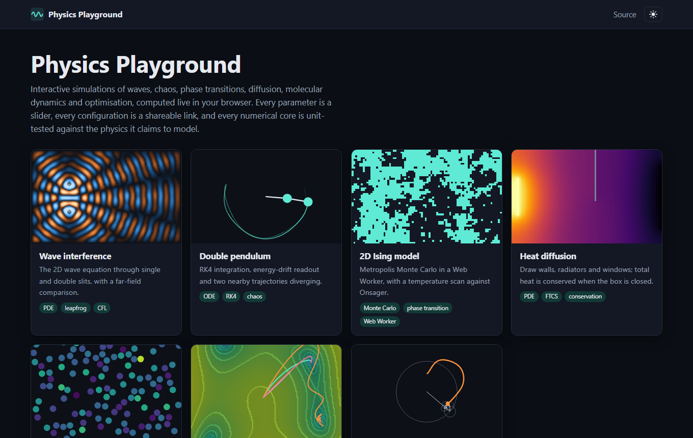

All images and animations in this README were captured from the running app by
[`scripts/capture.ts`](scripts/capture.ts) (Playwright). None are mock-ups.

## Simulations

| | Simulation | Method | What the tests check |
|---|---|---|---|
| 1 | [Wave interference](#1-wave-interference) | 2D wave equation, leapfrog | CFL limit, exact discrete energy, eigenmode frequency, Fraunhofer minima |
| 2 | [Double pendulum](#2-double-pendulum) | Lagrangian ODEs, RK4 | 4th-order convergence, dE/dt = 0, energy drift, normal modes, divergence |
| 3 | [2D Ising model](#3-2d-ising-model) | Metropolis Monte Carlo in a Web Worker | E and M of known configs, incremental bookkeeping, Onsager values |
| 4 | [Heat diffusion](#4-heat-diffusion) | Conservative FTCS | Heat conservation to 1e-12, steady state, variance growth, stability |
| 5 | [Lennard-Jones gas](#5-lennard-jones-gas) | Velocity Verlet, cell list | F = −dU/dr, cell list = brute force, momentum, energy, Maxwell–Boltzmann |
| 6 | [Optimizer race](#6-optimizer-race) | SGD, momentum, RMSProp, Adam | Hand-computed update steps, gradients, convergence behaviour |
| 7 | [Fourier epicycles](#7-fourier-epicycles) | DFT of a closed curve | Exact reconstruction, Parseval, truncation error |

### 1. Wave interference

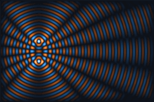

The scalar wave equation `u_tt + γ(x) u_t = c² ∇²u` on a 360 × 240 grid, integrated with the
second-order leapfrog scheme. The experiments are a double slit, a single slit and two coherent
point sources. A damping "sponge" around the border absorbs outgoing waves, so the domain behaves as
if it were open. The intensity view averages `u²` over time, and a screen plot along the right edge
overlays the simulated fringes on the Fraunhofer prediction
`I(θ) ∝ cos²(πd sinθ/λ) · sinc²(πa sinθ/λ)`.

Leapfrog is stable only for Courant numbers `C = cΔt/Δx ≤ 1/√2` in 2D. The slider stops there, and
the tests show the solver blowing up just above it.

<br clear="right" />

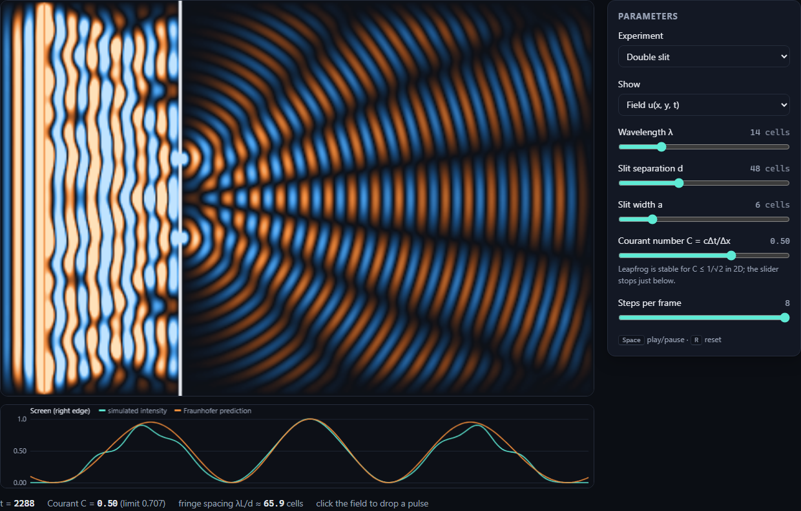
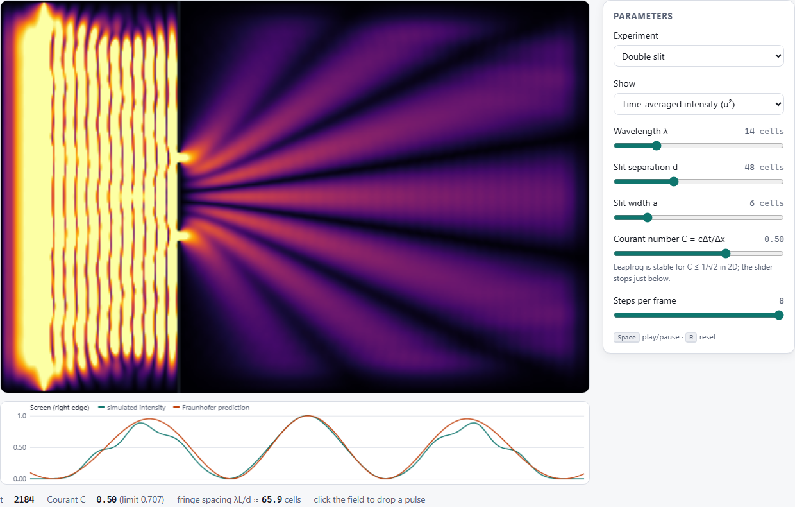

### 2. Double pendulum

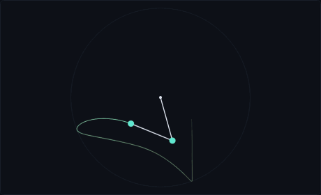

Two point masses on rigid rods. The Euler–Lagrange equations are solved explicitly for the angular
accelerations and integrated with classical RK4. A second, faint copy starts with θ₁ shifted by
δ₀ (1e-12 to 1e-2 rad). On a log plot their separation grows along a straight line, and the slope
estimates the largest Lyapunov exponent. Next to it, the energy error stays around 1e-9 of the energy
scale `(m₁+m₂)gℓ₁ + m₂gℓ₂`, which shows the divergence is chaos and not numerical error. The time step
is a slider, so you can watch RK4's `Δt⁴` error grow. Drag a bob to set the initial angles.

<br clear="right" />

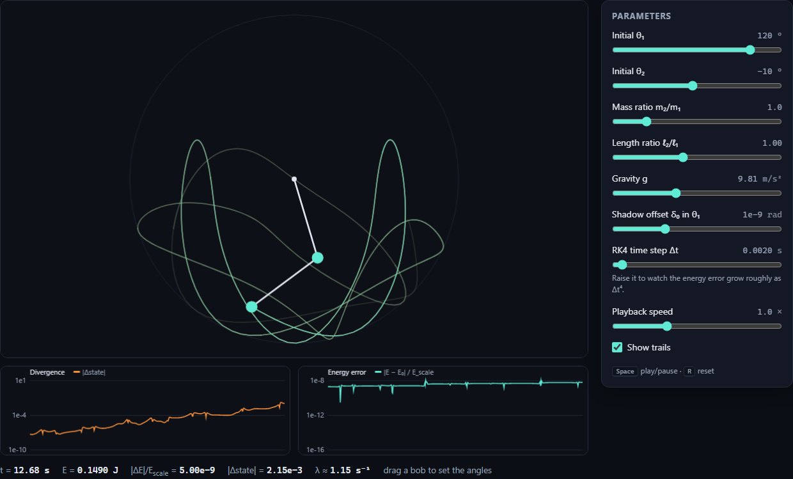

### 3. 2D Ising model

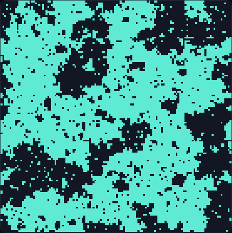

`H = −J Σ⟨ij⟩ sᵢsⱼ − h Σ sᵢ` on a periodic lattice (64², 128² or 256²), sampled with single-spin-flip
Metropolis. The ten possible acceptance probabilities are precomputed, and energy and magnetisation
are updated incrementally. Sweeps run in a **Web Worker** that hands back a transferred copy of the
spins once per animation frame, so the page stays at 60 fps even at 256² with 20 sweeps per frame.

The **temperature scan** (T = 1.0 → 3.5) measures ⟨|m|⟩, ⟨e⟩ and the susceptibility χ, and plots them
over Onsager's exact solution: `|m| = [1 − sinh⁻⁴(2J/kT)]^{1/8}`, and the internal energy with its
complete elliptic integral (computed with the arithmetic–geometric mean). The critical temperature
`Tc = 2/ln(1+√2) ≈ 2.269` shows up where |m| collapses and χ peaks.

<br clear="right" />

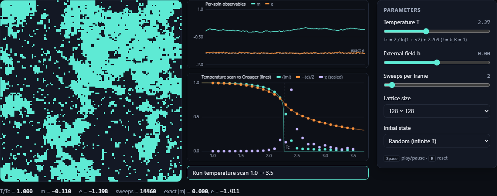

### 4. Heat diffusion

`u_t = α ∇²u` with explicit Euler in conservative flux form: only pairs of neighbouring non-wall cells
exchange heat, and each exchange is equal and opposite. Every wall you draw, and the edge of the
domain, is therefore perfectly insulating, and in a closed box the total heat is conserved to rounding
error. The readout shows a relative change of order 1e-15 to 1e-14. Brushes paint insulating walls, hot and cold
reservoirs (Dirichlet cells) or heat. The scheme is stable for `r = αΔt/Δx² ≤ 1/4`; the solver refuses
larger values and the tests show the blow-up above it.

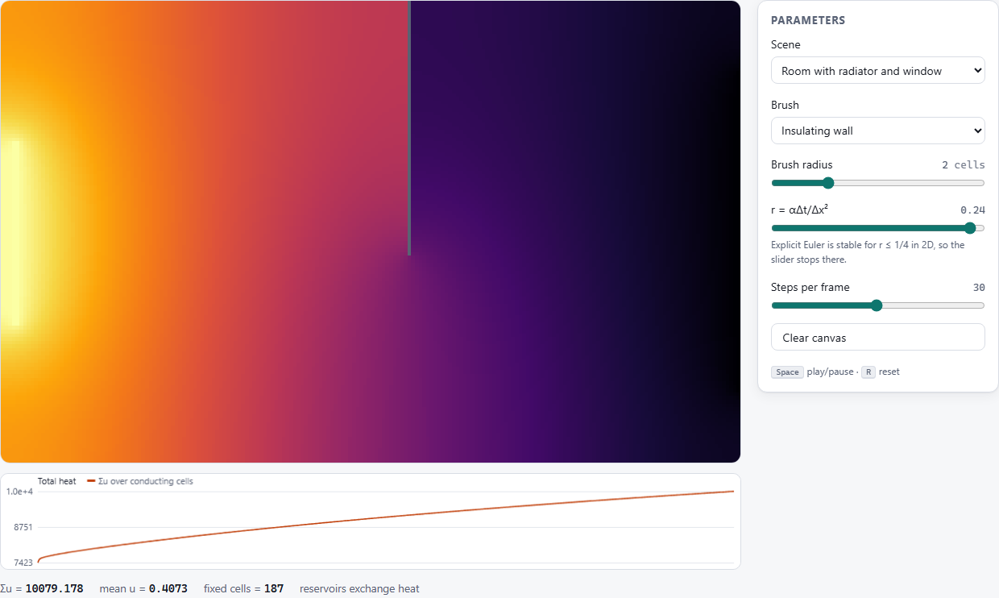

### 5. Lennard-Jones gas

Molecular dynamics of a 2D Lennard-Jones fluid in reduced units, with the potential truncated and
shifted at 2.5σ. Velocity Verlet, periodic boundaries with the minimum-image convention, and an O(N)
cell list that is tested against the O(N²) sum. The particles start on a square lattice. Collisions
quickly turn the speed histogram into the 2D Maxwell–Boltzmann distribution
`f(v) = (v/kT) exp(−v²/2kT)` at the measured kinetic temperature. The app also shows the virial
pressure, and you can switch between NVE and a Berendsen thermostat (NVT).

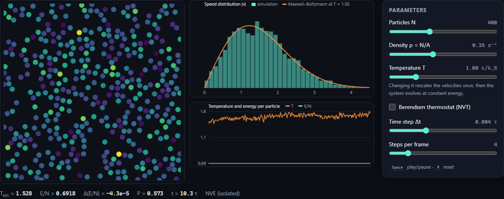

### 6. Optimizer race

SGD, heavy-ball momentum, RMSProp and Adam (with bias correction) descend the same surface from the
same start. The surfaces are an ill-conditioned rotated bowl (κ = 20), Rosenbrock's valley, Himmelblau's
four minima, a saddle with two wells, and Rastrigin. Click to choose the start point. You can scale the
learning rates, change β, add Gaussian gradient noise to imitate minibatches, and compare log-loss
curves. Trajectories are drawn incrementally on offscreen layers, so a long run costs the same per
frame as a short one.

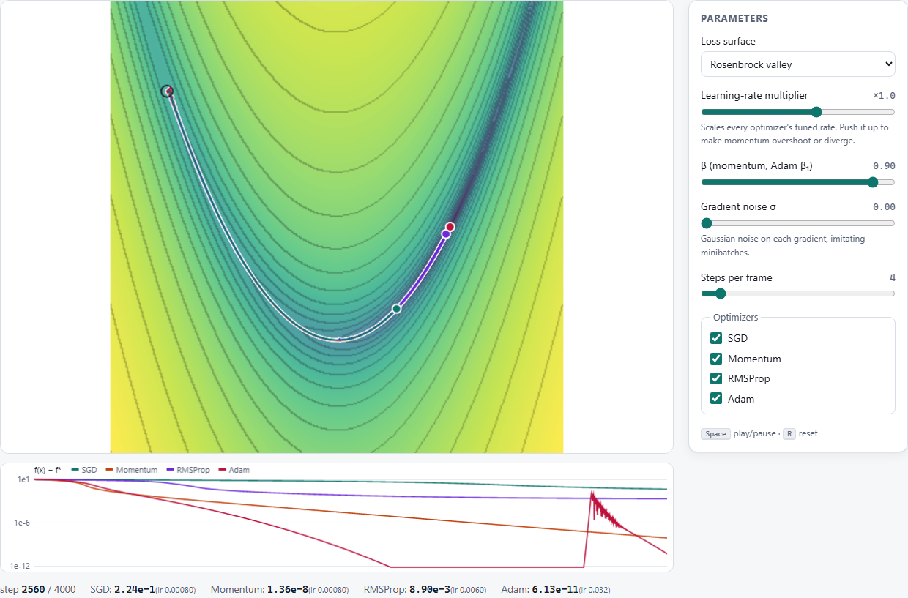

### 7. Fourier epicycles

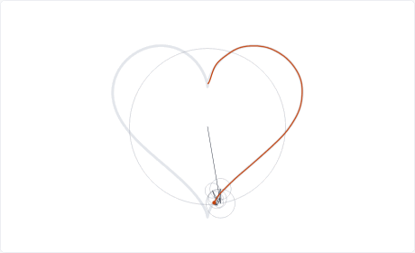

A closed curve `z(t) = x(t) + i y(t)` is resampled at 256 points equally spaced in arc length and
transformed with a DFT. Each coefficient becomes a rotating vector of length `|c_k|` and frequency `k`.
Pick a preset or **draw your own curve**, then change how many terms are kept. By Parseval's theorem the
relative RMS error of the truncated series is `√(Σ_omitted |c_k|² / Σ |c_k|²)`; the tests check that
this matches the measured error exactly.

<br clear="right" />

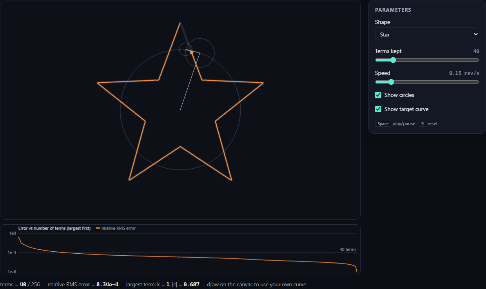

## Features

- **Shareable state.** Each simulation declares typed parameter specs (number with range and step,
  boolean, enum). The query string is parsed and clamped against the spec, and only non-default values
  are written back. The address bar is always a link to what you are looking at, and a hand-edited link
  cannot push a solver outside its stable range.
- **Play, pause, reset, copy link** on every page, with `Space` and `R` shortcuts that are ignored while
  you are typing in a control.
- **60 fps**: grid fields are written straight into `ImageData` through packed RGBA lookup tables, the
  animation loop only steps while running, paused pages cost nothing, and gallery thumbnails only animate
  while visible.
- **Keyboard and screen-reader friendly**: native range/select/checkbox controls with labels and value
  text, visible focus rings, a skip link, and `prefers-reduced-motion` support (simulations start paused
  and thumbnails show a still).
- **Light and dark themes** (OS default, persisted toggle). Canvases read their palette from CSS
  custom properties.
- **Responsive** layout: the parameter panel moves below the canvas on narrow screens.

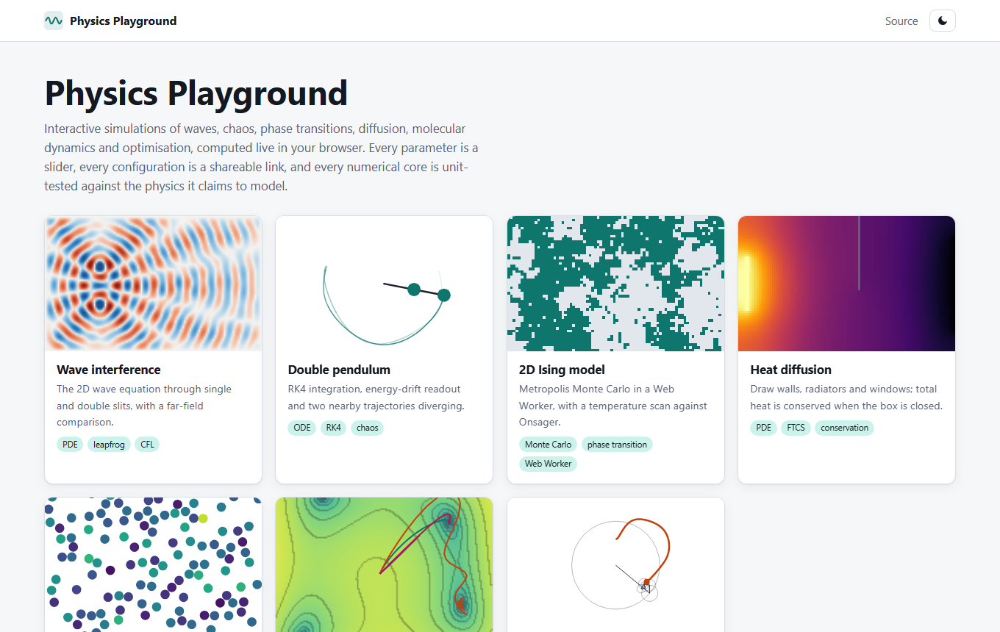

## Project structure

```
src/
  physics/            Pure numerical cores, no DOM: tested directly by Vitest
    wave.ts           leapfrog solver, sponge, slits, sources, discrete energy, Fraunhofer
    ode.ts            allocation-free RK4
    pendulum.ts       double-pendulum equations of motion, energies, normal modes
    ising.ts          Metropolis lattice, Onsager exact solution, elliptic K via AGM
    heat.ts           conservative FTCS, walls and reservoirs, presets
    lj.ts             Lennard-Jones MD: Verlet, cell list, thermostat, Maxwell-Boltzmann
    optim.ts          loss surfaces, SGD / momentum / RMSProp / Adam
    fourier.ts        arc-length resampling, DFT, epicycles, Parseval error
  sims/<name>/        One folder per simulation: Vue component, URL param specs,
                      drawing helpers and the gallery thumbnail
  sims/ising/ising.worker.ts   Metropolis sweeps off the main thread
  sims/registry.ts    Gallery order, lazy-loaded components and thumbnails
  components/         SimLayout, LinePlot, controls, KaTeX renderer, thumbnails
  composables/        animation loop, URL-backed params, canvas sizing, theme
  lib/                param parsing, colormaps, seeded PRNG, rolling series
tests/                Vitest unit tests for every numerical core
e2e/                  Playwright smoke tests against the production build
scripts/capture.ts    Regenerates every screenshot and GIF in docs/media
```

## Local development

Requires Node 22 or newer (`.nvmrc` pins 24).

```bash
npm install
npm run dev          # Vite dev server
npm run lint         # ESLint (flat config, Vue + TypeScript)
npm run typecheck    # vue-tsc, project references
npm test             # Vitest unit tests
npm run build        # typecheck + production build into dist/
npm run preview      # serve dist/
```

End-to-end tests and media capture use Playwright's Chromium:

```bash
npx playwright install chromium
npm run test:e2e     # builds are served with vite preview
npm run capture      # rewrites docs/media/*.png|gif from the running app
```

## Testing

- **81 unit tests** in 11 files (`tests/`), covering the numerical cores and the shared libraries.
  Some highlights:
  - wave: stable at C = 0.70 and blows up at C = 0.75; the discrete leapfrog energy is conserved to
    1e-9; an eigenmode's frequency matches the analytic discrete dispersion relation to 1e-9.
  - pendulum: RK4 error falls ~16× when Δt halves; energy drift below 1e-6 over 20 s of chaotic
    motion; the small-angle period matches the normal-mode frequency.
  - Ising: E and M of all-up, checkerboard, stripe and wrap-around configurations; the Monte Carlo
    ⟨|m|⟩ and ⟨e⟩ agree with Onsager within 0.02.
  - heat: total heat conserved to 1e-12 with insulated walls; linear steady state; variance grows
    by 2r per step per axis; maximum principle at r = 1/4.
  - Lennard-Jones: cell list equals brute force to 1e-9; momentum conserved to 1e-10; the equilibrium
    speed histogram matches Maxwell–Boltzmann within 0.03 total variation.
  - optimizers: hand-computed momentum, RMSProp and Adam steps (including bias correction).
  - Fourier: Parseval, and the truncation error equals its prediction for 1 to 81 terms.
- **13 end-to-end tests** (`e2e/`): every page renders, animates and logs **nothing** to the browser
  console. Keyboard shortcuts, URL round-trips, clamping of bad URLs, the theme toggle and the 404 page
  are covered too.
- **CI** (GitHub Actions) runs ESLint, `vue-tsc`, Vitest and a production build on every push and pull
  request, plus the Playwright suite in a parallel job.

## Deployment

`npm run build` produces a fully static site in `dist/`. `vercel.json` rewrites deep links such as
`/sim/ising?T=2.27` to `index.html`, so the app can be served from Vercel or any static host with an
SPA fallback.

## License

[MIT](LICENSE) © 2026 Shabnaz Ghaffari
